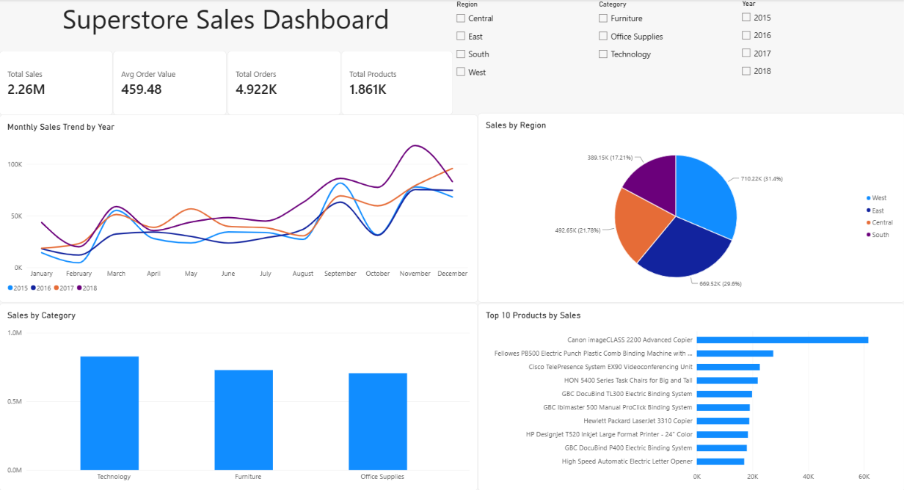

# Superstore Sales Analysis & Dashboard

An end-to-end sales analytics project covering data cleaning, exploratory analysis, and interactive dashboard design — built to demonstrate a complete data analysis workflow from raw data to business insights.



---

## Project Overview

This project analyzes four years (2015–2018) of retail transaction data from a fictional superstore to uncover trends in sales performance, customer behavior, and product/category profitability. The goal was to turn raw transactional data into a decision-ready dashboard that a business stakeholder could use to spot trends, compare regions and categories, and identify growth opportunities — without needing to read a single line of code.

**Type:** Personal / portfolio project
**Role:** Data cleaning, exploratory data analysis, dashboard design

---

## Objectives

- Clean and prepare raw sales data for analysis
- Explore sales trends across time, product categories, and regions
- Identify top-performing and underperforming products, categories, and regions
- Build an interactive dashboard for at-a-glance business reporting
- Translate the analysis into clear, actionable insights

---

## Dataset

- **Source:** Superstore Sales Dataset (public retail transactions dataset)
- **Time period:** 2015 – 2018
- **Size:** ~1,000 transactions, 18 columns
- **Key fields:** Order ID, Order Date, Ship Date, Customer, Region, Category, Sub-Category, Product Name, Sales

---

## Tools & Technologies

| Tool | Purpose |
|---|---|
| **Python** (Pandas, NumPy) | Data cleaning and preprocessing |
| **Matplotlib / Seaborn** | Exploratory data analysis and static visualizations |
| **Power BI** | Interactive dashboard and business reporting |

---

## Data Cleaning & Preparation

Using Python and Pandas, the raw dataset was cleaned and prepared before analysis:

- Inspected row/column counts, data types, and missing values
- Checked for and handled duplicate records
- Converted `Order Date` and `Ship Date` to proper date format (day-first locale)
- Verified and corrected data types across all columns
- Created derived columns for time-based analysis: **Month**, **Year**, **Day of Week**

---

## Exploratory Data Analysis

Key questions explored during the Python-based EDA phase:

**Sales**
- What is the total revenue and average order value?
- How many total orders were placed?

**Products**
- Which products and categories generate the most (and least) revenue?

**Time**
- How do sales trend month-to-month and year-over-year?
- Is there a seasonal sales pattern?

**Region**
- Which regions and cities drive the most revenue?

Six supporting charts (monthly sales, category sales, top 10 products, regional sales, order value distribution, and quantity vs. sales) were produced with Matplotlib/Seaborn to validate patterns before building the dashboard.

---

## Dashboard

The final deliverable is an interactive **Power BI dashboard** with:

**KPI Cards**
- Total Sales
- Total Orders
- Average Order Value
- Total Products

**Visuals**
- Monthly Sales Trend by Year (line chart)
- Sales by Region (pie chart)
- Sales by Category (column chart)
- Top 10 Products by Sales (bar chart)

**Interactive Filters (Slicers)**
- Year
- Region
- Category

The dashboard lets a user filter by any combination of year, region, and category, with every KPI and chart updating instantly.

---

## Key Insights

- **Overall performance:** Total sales reached **$2.26M** across **4,922 orders**, with an average order value of **$459.48** and **1,861 unique products** sold.

- **Consistent year-over-year growth (after a 2016 dip):** Sales dipped slightly in 2016 (**$459.44K**, -4.3% vs. 2015) before growing strongly — **+30.6%** in 2017 (**$600.19K**) and **+20.3%** in 2018 (**$722.05K**). 2018 alone accounted for roughly **32%** of total revenue and was about **50% higher** than 2015.

- **Growth driven by order volume, not order size:** The number of orders nearly doubled, from **947** in 2015 to **1,661** in 2018 (**+75%**). Over the same period, average order value declined from **$506.71** to **$434.71** (**-14%**) — indicating the business grew primarily by attracting more orders rather than higher-value purchases.

- **West is the strongest and fastest-growing region:** West leads with **$710.22K** (**31.4%** of sales), followed by East (**$669.52K**, 29.6%), Central (**$492.65K**, 21.8%), and South (**$389.15K**, 17.2%). West also posted the fastest growth from 2015–2018 (**+70%**), while South grew the slowest (**+18%**) and remains the weakest region.

- **Clear seasonality:** Sales are consistently lowest in January–February and rise sharply from September through December across all four years — a strong year-end sales pattern worth planning inventory and promotions around.

- **Category performance differs by purpose, not just size:**
  - **Technology** leads in revenue (**36.6%** of sales) and has the highest average order value (**$544.74**), driven by fewer, higher-priced products (404 unique items).
  - **Office Supplies** generates by far the highest order volume (3,676 category-level orders) but the lowest average order value (**$191.90**), reflecting a very wide, low-price catalog (1,082 unique products — over half of all products sold).
  - **Furniture** sits in between on most metrics (32.2% of sales, $421.92 average order value).

- **Sales are broadly distributed, not concentrated:** The single best-selling product accounts for only ~2.7% of total sales, and the top 10 products together represent roughly 11% of revenue out of 1,861 total products — revenue is spread across a large, diverse catalog rather than driven by a handful of bestsellers.

- **Multi-category orders are common:** The sum of orders counted per category (6,922) exceeds the total distinct order count (4,922), showing that a meaningful share of orders include items from more than one category — a potential opportunity for cross-selling strategies.

---

## Project Structure

```
Superstore-Sales-Analysis/
│
├── data/
│   └── superstore_sales.csv
│
├── notebooks/
│   └── sales_analysis.ipynb
│
├── dashboard/
│   └── sales_dashboard.pbix
│
├── visualizations/
│   ├── dashboard.png
│   ├── monthly_sales.png
│   ├── category_sales.png
│   ├── top_products.png
│   └── regional_sales.png
│
└── README.md
```

---

## How to View

- **Dashboard:** Open `dashboard/sales_dashboard.pbix` in Power BI Desktop (free download from Microsoft) to explore the fully interactive version.
- **Analysis:** Open `notebooks/sales_analysis.ipynb` in Jupyter Notebook to review the full data cleaning and EDA process.

---

## Author

**Mokhtar**
Part of a data analytics portfolio, alongside a web scraping project and a house price prediction machine learning model.
